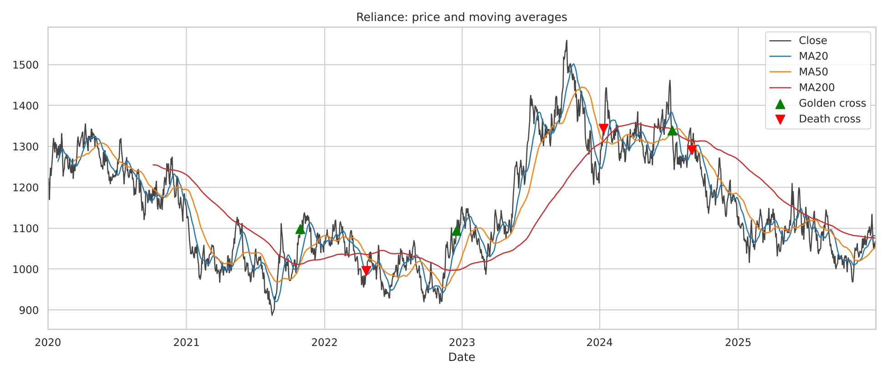
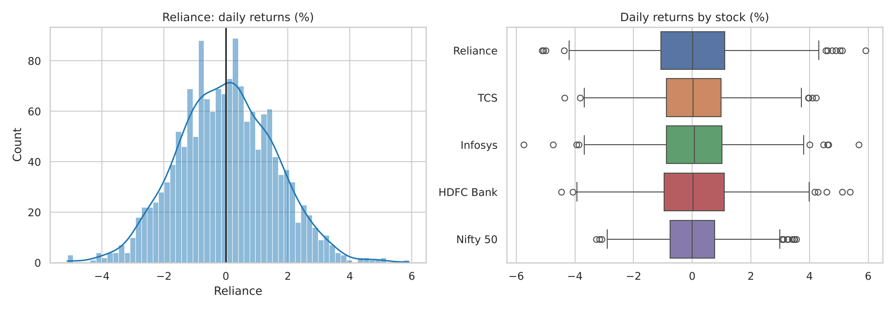
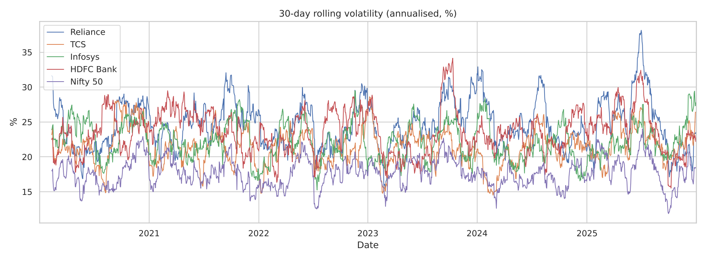
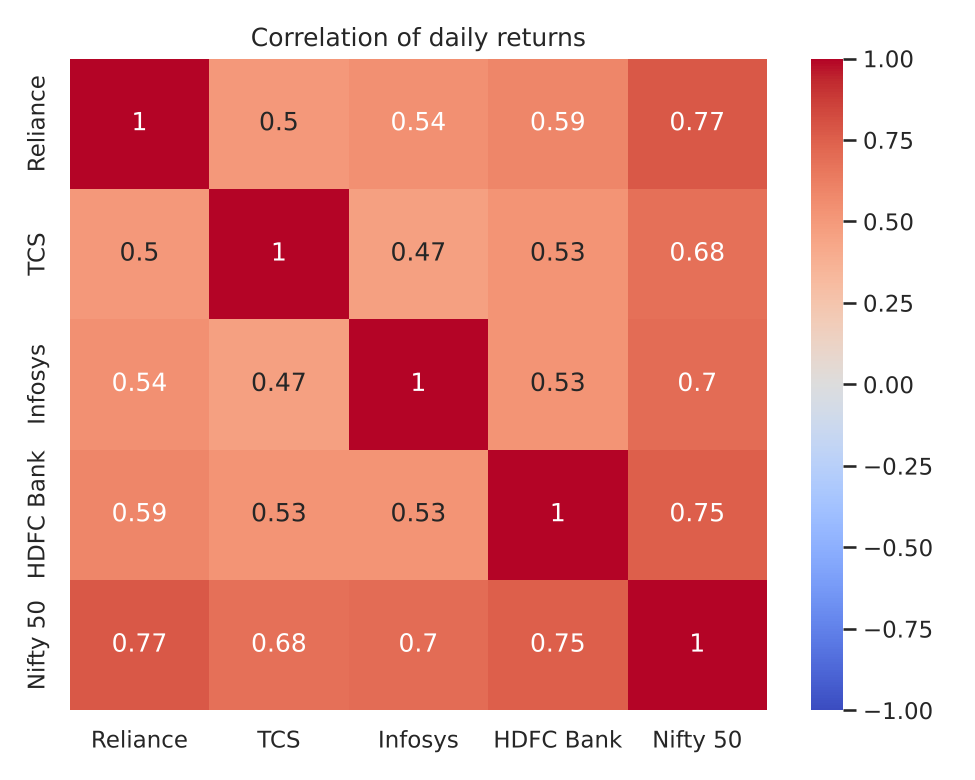
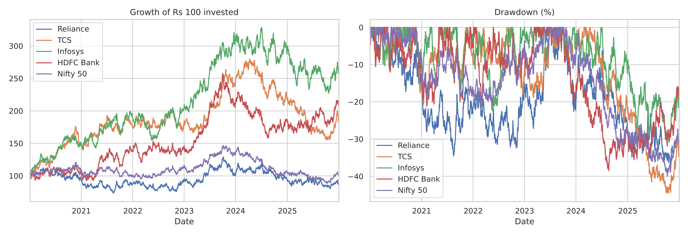

# Stock Market Dashboard

**Level:** Intermediate  
> Moving averages, daily returns, volatility and correlation for NSE stocks, pulled from the Yahoo Finance API.

> **Before you publish:** this repo ships with a *synthetic sample dataset* in the same format as the real one so everything runs out of the box. Download the real dataset (see below), put it at `data/prices.csv`, re-run, and replace the Key Insights section with your real numbers. Then delete this note.

## Business questions

- What do the 20/50/200-day moving averages signal?
- What do daily returns look like?
- How volatile is each stock?
- How correlated are the stocks?

## Dataset

- Yahoo Finance via the `yfinance` API (`python fetch_data.py`); falls back to synthetic prices when offline
- Expected location: `data/prices.csv` (search the dataset name on Kaggle to download it)
- If the file is missing, `generate_data.py` creates a sample with the same columns automatically.

## Skills demonstrated

APIs (yfinance), time series, rolling windows, risk metrics (Sharpe, drawdown), Plotly

## Project structure

```
README.md
analysis.ipynb         notebook (cells run top to bottom)
analysis.py            same analysis as a script
cleaned_dataset.csv
images/               charts used in this README
data/                 raw data goes here
generate_data.py      sample-data generator
requirements.txt
```

## How to run

```bash
pip install -r requirements.txt
python fetch_data.py          # downloads prices (needs internet)
python analysis.py             # or: jupyter notebook analysis.ipynb
```

Run `python fetch_data.py` with internet access to download real prices before running the analysis.
This is an educational analysis, not investment advice.

## Key insights

_Run the analysis and paste the five printed insights here, each with a recommendation. Example format:_

1. **Finding with a number** - e.g. "Month-to-month contracts churn at 3x the rate of two-year contracts."
   - *Recommendation:* what the business should do about it.
2. ...

## Visualizations







## Interview talking points

- Golden cross vs death cross and why moving-average signals lag.
- Annualising volatility (std x sqrt(252)) and what Sharpe ratio tells you.

## Resume bullet (fill in your numbers)

> Built a stock-analysis tool pulling live Yahoo Finance data: moving-average signals, volatility, correlation and drawdown for 4 NSE stocks vs Nifty 50.

## Tech stack

Python, Pandas, NumPy, Matplotlib, Seaborn, Jupyter
